# Processor Architecture

## Overview

The processor is implemented entirely in Logisim-Evolution. Its architecture is divided into several functional units, each responsible for a specific part of instruction processing, memory access, or system control.

The main architectural components include:
1. Program Counter (PC): Maintains the address of the current instruction and determines the next execution address.
2. Instruction Register (IR): Stores the currently fetched instruction.
3. Memory: Provides RAM and memory-mapped I/O.
4. Instruction Processing Units: Consists of a Instruction Decoder, a ValGen Unit, an ImmGen Unit, an ACU, and an ALU.
5. Register File: Stores general-purpose registers and provides operands for instruction execution.
6. Privileged Control Units: Manages CSR operations, privilege modes, exceptions, and interrupts.

## Clocking Scheme

The processor uses a two-phase clocking scheme stat separates combinational computation from state updates.

### CLOCK = 1 (Computation Phase)

During this phase, the processor evaluates the current instruction.

The instruction is processed by the Decoder, which generates the necessary control signals. The Immediate Generator reconstructs immediate values, while the ALU Control Unit (ACU) determines the required ALU operation.

The ALU performs the requested calculation, and other functional units prepare their respective results.

No architectural state updates are committed during this phase.

### CLOCK = 0 (State Update Phase)

During the second phase, the calculated results are written to the appropriate state elements. Depending on the instruction, this may update value of a Program Counter, Register File, CSR File, or even Memory.

This organization ensures that computation and state update occur in separate phases, making the execution process easier to observe in Logisim-Evolution.

## Instruction Processing

Instruction processing begins with fetching an instruction from memory. The PC provides the address to memory. The fetched instruction is stored in the IR.

During the computation phase, the IR provides the instruction to the ValGen Unit and Instruction Decoder.

### Decoding

The instruction Decoder uses a ROM-based implementation to generate the primary control signals based on the instruction opcode.

These signals include:
- RegWrite - enables writing to the Register File.
- ALUSrc - selects the second ALU operand source (0 = rs2; 1 = Immediate).
- MemRead - indicates a memory read operation.
- MemWrite - indicates a memory write operation.
- Branch - identifies conditional branch instructions.
- Jump - identifies unconditional jump instructions.
- ALUOp - determines how instruction function fields are interpreted by the ACU.
- ImmSel - selects the immediate format.

Additional opcode-specific signals are generated through separate decoding logic. These include signals for AUIPC, LUI, JALR, and system instructions.

This approach combines ROM-based control signal generation with additional opcode checks for instructions requiring special handling.

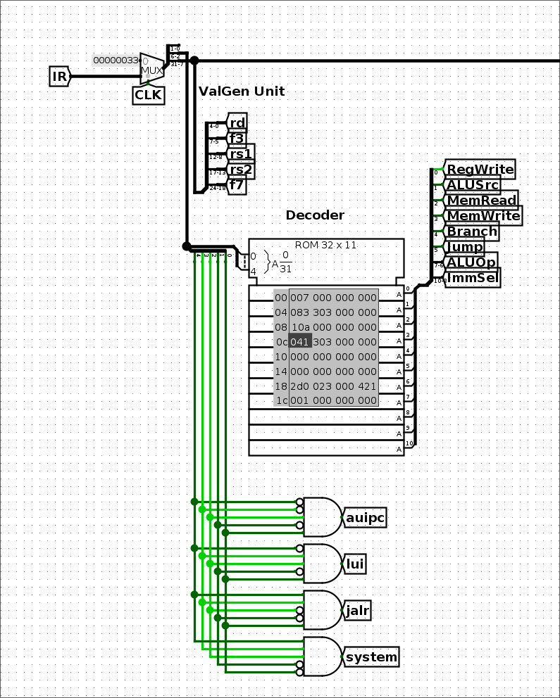

### ValGen Unit

The Value Generator Unit extracts the individual fields of the instruction.

It provides the values associated with the rd, f3, rs1, rs2, and f7 bit positions to other functional units.

These fields are not always interpreted as register addresses or function codes. Depending on the instruction format, some of them may contain immediate data instead.

For example, when an instruction does not use rd field as a destination register, its corresponding bits may represent part of an immediate value.

For CSR instructions, the rs2 and f7 bit positions are used together to provide the CSR address.

### ImmGen Unit

The Immediate Generator reconstructs immediate values from the instruction fields provided by ValGen.

The ImmSel control signal determines which immediate format is used.

The resulting value is supplied to the appropriate functional units, primarily the ALU.

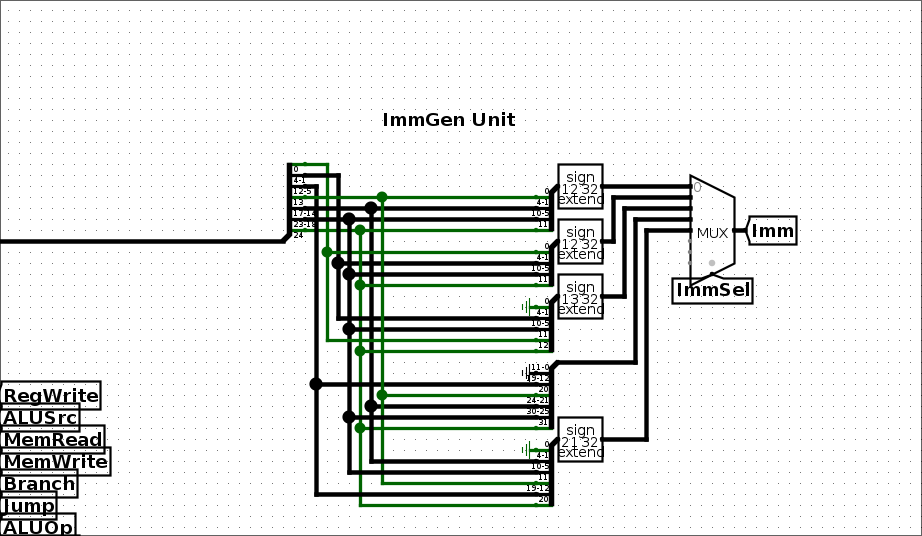

### ACU

The ALU Control Unit determines the operation performed by the ALU.

Is uses the ALUOp signal generated by the Instruction Decoder, together with the instruction function fields (f3 and f7)

It supports four operation categories:
| ALUOp | Instruction category                     | Operational selection                  |
|-------|------------------------------------------|----------------------------------------|
| 00    | Load/Store                               | Addition (offset calculation)          |
| 01    | Immediate arithmetic and logical         | Based on f3, with f7 checks for shifts |
| 10    | Register-register arithmetic and logical | Based on f3 and f7                     |
| 11    | Conditional branches                     | Based on f3                            |

This organization allows the ALU to support different instruction categories while keeping operation selection separate from the main instruction decoder.

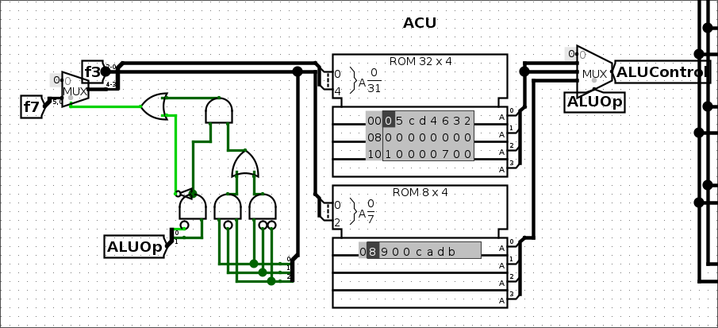

### ALU

The Arithmetic Logic Unit performs arithmetic and logical operations.

It does arithmetic calculations, bitwise logical operations, shift operations, memory address calculations for load and store instructions, and conditional branch comparsions.

The ALU receives its operands from the Register File, the ImmGen, or the PC, depending on the instruction being executed.

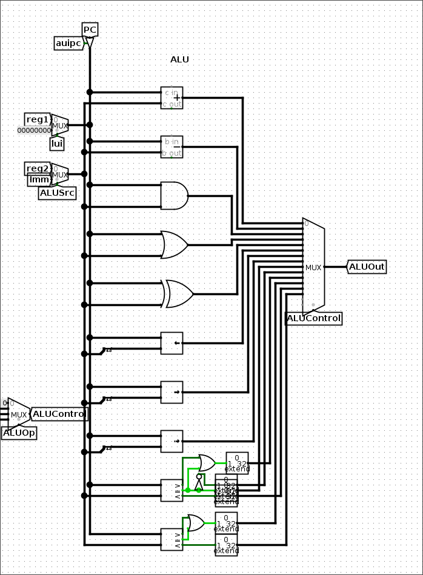

## Datapath

The processor uses a unified datapath in which multiple functional units exchange data through shared connections and multiplexers.

### Memory Access

The memory address is selected between the Program Counter and the ALU output.

During instruction fetching, the Program Counter provides the address of the instruction. For Load and Store instructions, the ALU calculates the needed memory address.

The memory output is directed either to the Instruction Register or to the Register File, depending on the current operation.

### Register File

The Register File contains 32 general-purpose registers.

It provides two read ports, selected by rs1 and rs2, and one write port addressed by rd.
| Source         | Condition   |
|----------------|-------------|
| ALU output     | Default     |
| Memory output  | MemRead = 1 |
| PC             | Jump = 1    |
| CSRFile output | system = 1  |

Register writes are controlled by RegWrite control signal.

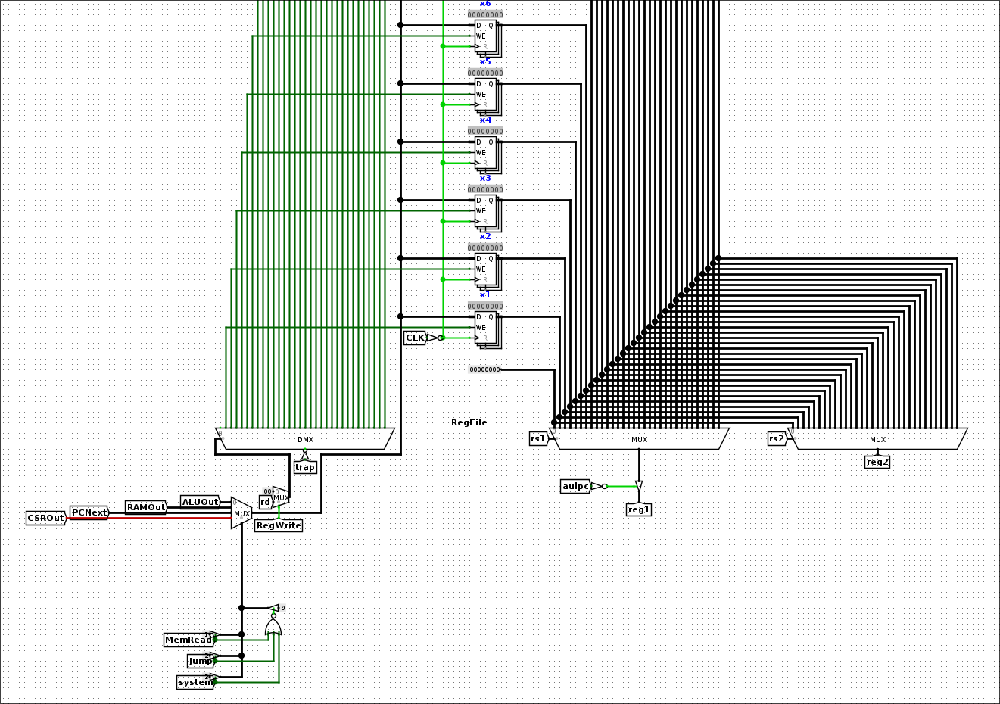

### PC

The Program Counter maintains the address used for instruction fetching.

Its next value depends on the current instruction and system control signals. It supports sequential execution, conditional branches, jumps, and privileged control-flow operations.

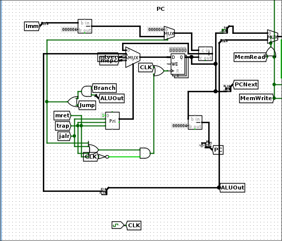

## Memory

### Von Neumann Memory

The processor uses a unified memory system shared between instruction fetching and data, which means that instructions and program data occupy the same memory space.

The memory system also includes memory-mapped I/O (MMIO), allowing the processor to interact with external peripherals through memory addresses.

### Banked RAM Organization

The RAM is implemented using four separate byte-wide memory banks.

Each bank stores one byte from every 32-bit word, e. g. bank 0 stores the first byte, bank 1 stores the second byte, bank 2 stores the third byte, bank 3 stores the fourth byte.

The four banks operate in parallel, allowing the processor to access a complete 32-bit word through a single memory access operation.

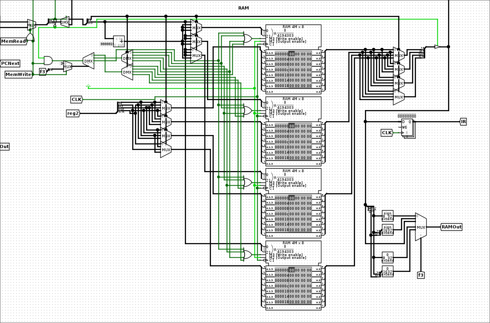

### Unaligned Memory Access

The memory system supports unaligned Load and Store operations.

Instead of requiring every access to begin at a word-aligned address, the address-generation logic distributes the required byte access across the four memory banks.

The addresses supplied to individual banks are adjusted according to the requested access address. The resulting bytes are then arranged in the correct order.

For example, a 32-bit Load beginning at address 0x1 requires bytes from addresses 0x1, 0x2, 0x3, and 0x4. 

The memory system retrieves these bytes from the appropriate banks and reconstructs the requested 32-bit value.

This approach allows unaligned accesses without requiring multiple sequential memory requests.

### MMIO

The processor includes an MMIO subsystem for communication with external peripherals.

The implemented devices include a terminal interface, a display, a keyboard, and a timer based on mtime and mtimecmp.

These peripherals provide basic interaction between software running on the processor and its external environment.

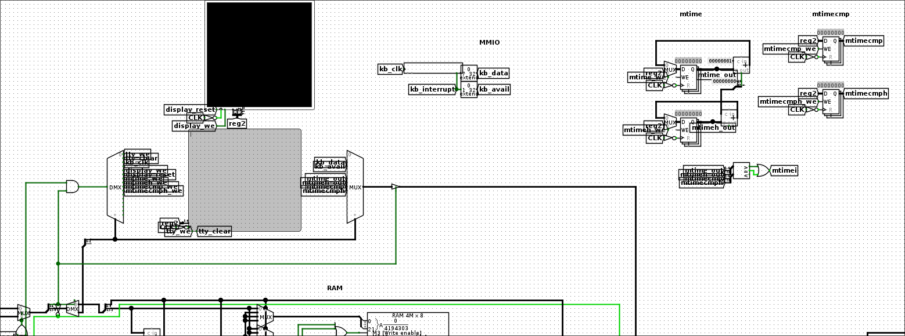

## Privileged Architecture

The processor implements selected privileged functionality, supporting Machine and User privilege modes.

Its privileged subsystem consists of three main components: CSRFile, CSR Logic Unit (CSRLU), and System Control Unit (SysControl).

### CSR File

The CSRFile stores the Control and Status Registers used by the privileged subsystem.

The implementation includes six CSRs:

| CSR      | Purpose                                                      |
|----------|--------------------------------------------------------------|
| mstatus  | Machine status and privilege-related state                   |
| mepc     | Stores the address associated with an exception or interrupt |
| mcause   | Stores the cause of an exception or interrupt                |
| mtvec    | Defines the machine trap-vector address                      |
| mscratch | provides a machine-mode scratch register                     |
| mie      | Stores interrupt enable bits                                 |

The CSRFile provides the storage and access interface required by CSR instructions and the SysControl Unit.

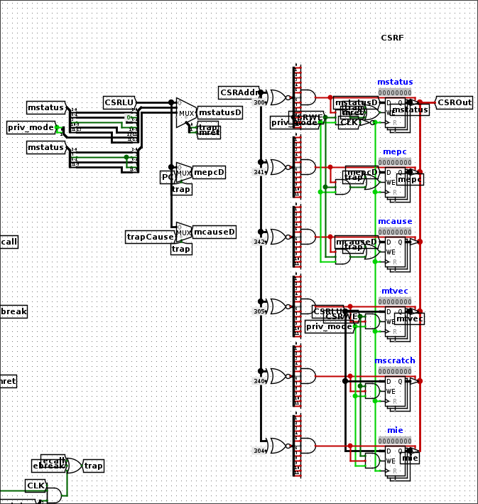

### CSRLU

The CSR Logic Unit performs logical operations between CSR values and general-purpose register or immediate values.

Its operation is controlled by the two-bit CSRWriteMode signal.

| CSRWMode | Operation                                  |
|----------|--------------------------------------------|
| 00       | No operation                               |
| 01       | Write the source value                     |
| 10       | Bitwise OR                                 |
| 11       | Bitwise AND with an inverted GPR/immediate |

The resulting value is supplied to the CSRFile for updating the corresponding register.

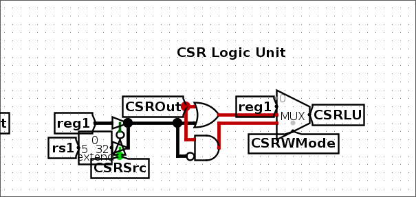

### SysControl Unit

The System Control Unit manages privileged operations and coordinates the CSR-related functional units.

When a system instruction is detected, the unit identifies its type and generates the corresponding control signals.

It handles the ECALL, EBREAK, and MRET instructions, controls CSR access, manages privilege-mode transitions, processes supported interrupts, and updates trap-related CSR values.

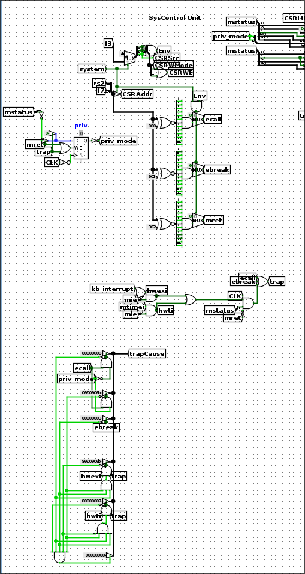

### Exception and Interrupt Handling

The implementation supports the following events:
- Environment calls from User mode and Machine mode.
- Breakpoint exceptions.
- Timer interrupts.
- External interrupts.

When an interrupt is accepted, the SysControl Unit determines its cause and selects the corresponding mcause value according to the implemented interrupt priority.

The CSR update logic also performs the required status transitions:
- The current MIE value is transfered to MPIE.
- The previous privilege mode is saved to MPP.
- The current privilege mode is updated.
- The current PC is stored in mepc.

The processor does not complete the interrupted instruction before entering the interrupt handler. Consequently, returning with MRET allows execution to resume at the interrupted instruction.

## Design Decisions and Limitations

Several implementation decisions were made to prioritize clarity and accesiblity.

### ROM-Based Instruction Decoder

While the most CPUs in HDL using a PLUT, Logisim-Evolution does not provide a PLUT. So, the main instruction decoder uses a ROM to generate the primary control signals.

Additional opcode checks provide signals for instructions requiring special handling.

This approach provides a relatively compact and straightforward implementation of instruction decoding using the components available in Logisim-Evolution.

### Two-Phase Clocking

The two-phase clocking scheme separates computation from state updates.

This makes the processor's internal operation easier to observe and provides a clear distinction between calculating results and committing them to architectural state.

### Banked Memory

The four-bank RAM implementation supports unaligned memory accesses while maintaining a single memory access operation.

Although the resulting circuit is relatively complex, it provides the required functionality without introducing additional sequential memory requests.

### Implementation Scope

The project focuses on providing an understandable educational implementation rather than reproducing the complete RUSC-V architecture.

The processor provides privileged functionality limited to the implemented CSRs, privilege transitions, exceptions, and interrupt sources.

The design should therefore be considered a selected implementation of RISC-V functionality rather than a complete implementation of the RISC-V privileged architecture specification.

# Navigation

[< Previous: Introduction](introduction.md)
